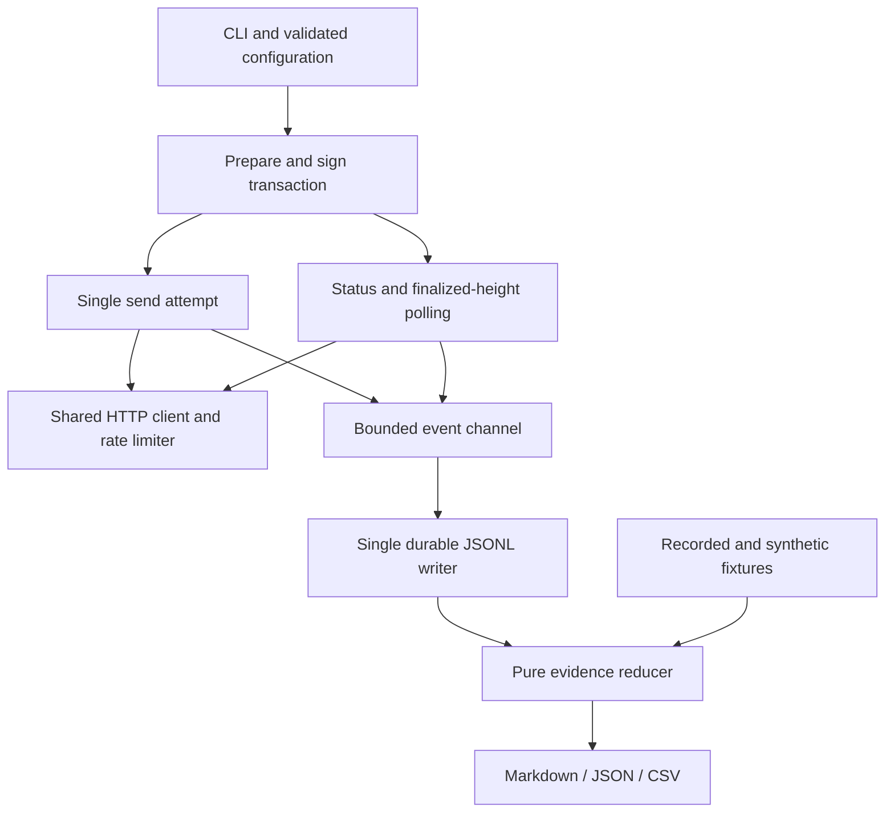

# TxTrail

An evidence-first Solana transaction debugger in Rust. Record submission, execution, validity, and observation separately; replay the same evidence offline.

An RPC acknowledgement does not establish execution. A timeout or missing status does not prove that a transaction was dropped. TxTrail preserves that uncertainty.

## Build and offline demo

Requires Rust 1.91 or later. Commit and use `Cargo.lock` (transaction construction uses Solana SDK 2.1.7).

```sh
cargo build --locked
cargo run -- replay --input tests/fixtures/ack-timeout-then-finalized.jsonl
cargo run -- replay --input tests/fixtures/success.jsonl --format json
cargo run -- export --run tests/fixtures/unresolved-deadline.jsonl --format csv
cargo run -- doctor --config config/local.toml --offline
```

After downloading dependencies, builds and default tests can use `--offline`. Fake RPC tests bind ephemeral loopback ports; they need no validator or public endpoint.

## Local walkthrough

Install the Solana CLI and `solana-test-validator` separately. In one terminal, start a dedicated test ledger:

```sh
mkdir -p .local
solana-test-validator --ledger .local/demo-ledger
```

In another terminal, create and fund a throwaway wallet. Keep the wallet private; `.local/` is ignored.

```sh
solana-keygen new --outfile .local/dev-wallet.json
solana --url http://127.0.0.1:8899 airdrop 2 .local/dev-wallet.json
cargo run -- doctor --config config/local.toml
cargo run -- send --config config/local.toml --keypair .local/dev-wallet.json
```

The CLI prints `Recording run: runs/<run-id>` on stderr and a report on stdout. Each send signs one distinct legacy System Program transfer to a freshly generated recipient, funded above the queried rent minimum. The recipient's private key is discarded; use only test funds. All HTTP operations share a limiter. Defaults use one request per second and a 120-second observation deadline, followed by at most 20 seconds of history lookups.

Reproduce both kinds of failure locally:

```sh
cargo run -- send --config config/local.toml --keypair .local/dev-wallet.json --workload preflight-error
cargo run -- send --config config/local.toml --keypair .local/dev-wallet.json --workload execution-error
```

Both use deliberately invalid System Program instruction data. `preflight-error` enables simulation; `execution-error` skips it so the validator can record a landed execution failure. These workloads are rejected for devnet.

## Saved evidence and recovery

```sh
cargo run -- report --run runs/<run-id> --format markdown
cargo run -- inspect --run runs/<run-id> --signature <signature>
cargo run -- export --run runs/<run-id> --format csv
cargo run -- reconcile --run runs/<run-id> --config config/local.toml
```

Report, inspect, export, and replay never contact RPC. Reconcile verifies the original network, appends a new session, and observes existing signatures without signing or resending. It cannot recover latency across process sessions. Ctrl-C saves an incomplete finish when storage remains available; reconcile later to obtain more evidence.

JSONL is authoritative. The recorder assigns sequence numbers, locks against concurrent writers, and flushes each event to durable storage before acknowledging it. Bounded queues apply backpressure; saturation suppresses latency estimates. Storage failures abort capture. A truncated final record is recoverable for offline reporting with a warning; interior corruption fails with its line number. Reconciliation refuses a truncated log: preserve the original, make a copy containing only complete records, then reconcile the copy. Never remove a malformed interior record to disguise corruption.

Command exit status is zero when capture/reporting completed, even if the transaction failed or remains unresolved. Inspect the structured `outcome` in JSON/CSV. Configuration, transport setup, storage, and invalid evidence errors return nonzero.

## Public devnet

The devnet profile permits only `https://api.devnet.solana.com` and verifies its genesis identity. Local profiles require loopback and reject known public-cluster identities. Mainnet and paid services are outside this release.

```sh
cargo run -- doctor --config config/devnet.toml
solana --url https://api.devnet.solana.com airdrop 1 .local/dev-wallet.json
cargo run -- send --config config/devnet.toml --keypair .local/dev-wallet.json
```

Start with one transaction. Faucet or RPC unavailability is an external blocker, not proof of a transaction failure. Do not load-test the public endpoint. WebSocket subscriptions are deferred; setting `websocket_enabled = true` produces an explicit error. The observation target must be `finalized`; earlier commitments are preserved as tentative evidence.

## Architecture



`model.rs` defines evidence and state; `reducer.rs` interprets it; `store.rs` owns persistence; `rpc.rs` validates responses; `transaction.rs` constructs the workload; `runner.rs` coordinates submission, polling, and reconciliation; `report.rs` derives metrics.

## Verification

```sh
cargo fmt --check
cargo clippy --locked --all-targets -- -D warnings
cargo test --locked
TXTRAIL_LOCAL_CONFIG=config/local.toml TXTRAIL_LOCAL_KEYPAIR=.local/dev-wallet.json \
  cargo test --test local_e2e -- --ignored
```

The opt-in test submits three local transactions, including intentional failures. It never starts or resets your validator. Default tests use synthetic fixtures and a small server built with Rust's `std::net::TcpListener`.

## Measurements and validation

Durations use monotonic time within one process session. They include polling and request scheduling, so they measure client observation latency, not true execution time. Reconciliation cannot establish cross-session latency. Success and unresolved fractions include all unique submitted transactions in their denominator. Quantiles use nearest rank and disclose sample count; small samples do not establish tail performance. Saturated capture suppresses latency estimates.

On 21 November 2026, local Agave 4.0.0 validation passed success, preflight rejection, and landed execution failure. Public devnet health checks passed, but its faucet request failed; no devnet submission was validated. WebSocket support remains deferred.

Reproduce the serialization experiment:

```sh
cargo run --release --locked --example serialization_bench
```

On macOS arm64 with Rust 1.91.0, seven paired trials of 80,000 fixture events measured median serialization time of 29.179 ms with fresh buffers (range 28.668–40.995 ms) and 21.576 ms with a reused buffer (range 21.238–21.964 ms): a 26.1% reduction. Both paths warm up first, alternate measurement order, and verify identical bytes. This excludes durable disk flushes and network work; it is not an end-to-end performance claim.

Generated reports, local validation traces, detailed working notes, and benchmark output stay local. Deterministic test fixtures and benchmark source are tracked.
